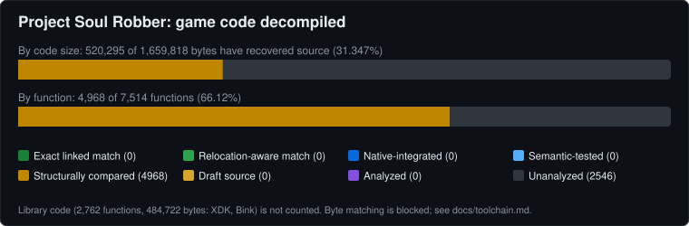

# Project-Soul-Robber

A source-reconstruction and decompilation project for The Nightmare Before Christmas: Oogie's Revenge (Xbox, 2005). A companion to [Project Oogie](https://github.com/Pallypots/ProjectOogie), focused on readable, maintainable code, faithful gameplay, and a foundation for native Windows, Linux, and Android ports, high-refresh-rate rendering, and expanded mod support.

## Progress

Only the game's own code is counted (7,735 functions). The statically linked Microsoft XDK libraries and Bink video code are tracked separately and will be replaced by PC code, not decompiled. Full table: [docs/progress.md](docs/progress.md). The chart is regenerated with `py -3 tools/progress.py`.

What the colours mean:

| State | Meaning |
|---|---|
| Exact linked match | Rebuilt bytes match the original at the original addresses |
| Relocation-aware match | Bytes match apart from documented address differences |
| Native-integrated | Runs in a native PC build without the recomp |
| Semantic-tested | Swapped into the working Project Oogie recomp and passed behaviour tests |
| Structurally compared | Readable C whose compiled form was checked step by step against the original; not a byte match |
| Draft source | Readable C written, not yet checked |
| Analyzed | Studied, no source yet |
| Unanalyzed | Not started |

Byte matching is currently blocked: the original Xbox compiler only shipped in Microsoft's XDK, which is not legitimately obtainable. Details in [docs/toolchain.md](docs/toolchain.md).

## What this is (and is not)

- A true decompilation: readable C/C++ recovered function by function from the US retail `default.xbe` (SHA-1 `667c5bd8abc4a551ef6b7cbab3bf3a45e7244605`).
- Not a static recompilation. Project Oogie is the playable recomp and serves as the test bench for recovered functions.
- **No game files are included.** You need your own copy of the game.
- Independent reverse engineering. No leaked source, symbols or SDK files are used. See [docs/provenance.md](docs/provenance.md).

## Docs

[STATE](docs/STATE.md) · [PLAN](docs/PLAN.md) · [Inventory method](docs/inventory.md) · [Toolchain](docs/toolchain.md) · [Recomp test bench plan](docs/swap_plan.md)
